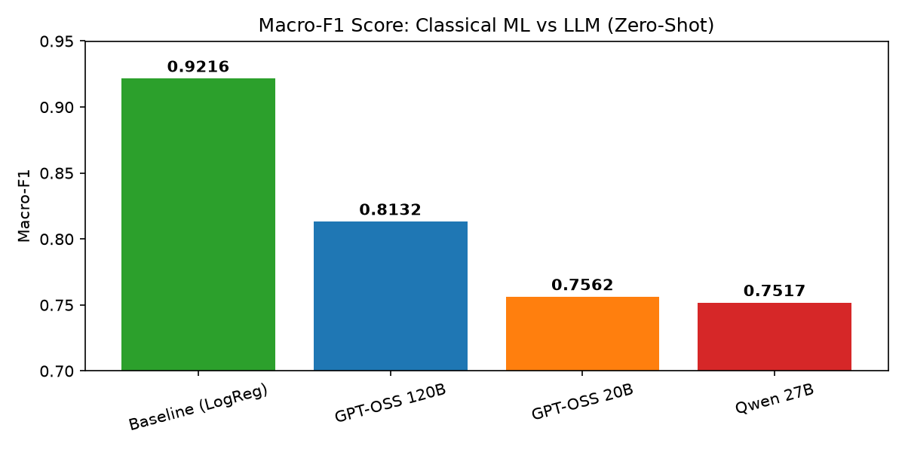
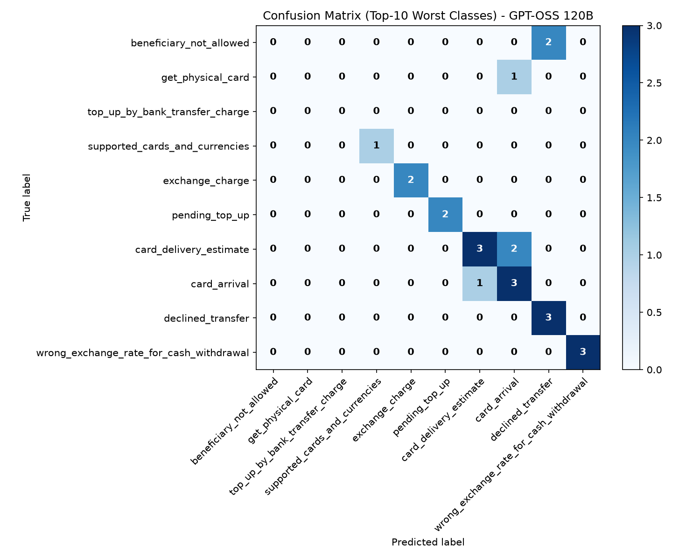

# Bank Support Intent Classification: Classical ML vs LLM

A comparison of a classical baseline (TF-IDF + Logistic Regression) and several LLMs on intent classification for bank customer support requests. Besides predictive quality (macro-F1), the project looks at practical aspects: response time, API rate limits, and format adherence (JSON parse errors).

## Dataset and EDA

The project uses [Banking77](https://www.kaggle.com/datasets/sssonnn/banking77/data): 77 intent classes, short customer queries in English.

| Split | Size | Notes |
| :--- | :--- | :--- |
| Train | 10,003 | Imbalanced class distribution |
| Test | 3,080 | Balanced, 40 samples per class |

Both splits have no missing values and no full duplicates. For the LLM experiments, two stratified subsets of the test set were used:
1. **Main benchmark:** 385 samples (5 per class).
2. **Prompt comparison:** 77 samples (1 per class).

## Methodology
**Baseline.** TF-IDF + Logistic Regression (scikit-learn), `class_weight="balanced"` to compensate for the imbalance in the train set.

**LLMs.** Accessed through the Groq API:
- `openai/gpt-oss-120b`
- `openai/gpt-oss-20b`
- `qwen/qwen3.8-27b`

**Prompts.**
- **v1 (zero-shot):** the list of 77 classes and a strict JSON output schema.
- **v2 (few-shot):** v1 plus a few rules and one training example per class.

**Evaluation details.**
- A response that cannot be parsed is counted as an incorrect prediction.
- Malformed JSON was retried up to 2 times. Responses that still failed are reported as parse errors.
- `llm_label.py` saves progress after every request, so a run interrupted by a rate limit continues from where it stopped.

### Main benchmark (zero-shot, n=385)

| Model | Macro-F1 | Accuracy | Parse errors |
| :--- | :--- | :--- | :--- |
| **Baseline (LogReg)** | **0.9216** | **0.9221** | 0 (0.0%) |
| GPT-OSS 120B | 0.8132 | 0.8130 | 32 (8.3%) |
| GPT-OSS 20B | 0.7562 | 0.7506 | 52 (13.5%) |
| Qwen 27B | 0.7517 | 0.7740 | 0 (0.0%) |



### Prompt comparison (n=77)

| Model | Macro-F1 | Accuracy |
| :--- | :--- | :--- |
| Baseline (LogReg) | 0.8680 | 0.8961 |
| GPT-OSS 120B, v1 (zero-shot) | 0.7650 | 0.8052 |
| GPT-OSS 120B, v2 (few-shot) | 0.7479 | 0.7792 |

With 77 samples, the difference between v1 and v2 is two examples (62 vs 60 correct answers), so this experiment does not allow a firm conclusion about few-shot prompting.

## Key Findings
1. **On this task the classical baseline outperformed all tested LLMs.** With about 10k labeled examples available, TF-IDF + LogReg is a strong, cheap and fast option. 
2. **Few-shot prompting showed no measurable improvement** (macro-F1 0.765 to 0.748), but the sample is too small to draw a firm conclusion. I did not test it yet. 
3. **GPT-OSS models frequently broke the output format.** 8 to 13% of their responses could not be parsed (refusals and invalid JSON). Qwen 27B always returned valid JSON, but its classification quality was lower.
4. **Speed and cost differ sharply.** LLM calls took roughly 2 to 5 seconds per request and regularly hit API free-tier rate limits, while the baseline runs locally in milliseconds.


## Error Analysis

The LLM mostly confuses semantically close classes, for example `card_arrival` and `card_delivery_estimate`.

## Limitations
- Small evaluation subsets (385 and 77 samples), so differences of a few percentage points are within noise.
- The LLMs were evaluated zero-shot (and one few-shot variant) with a single prompt each, without prompt tuning.
- The baseline has access to the full labeled train set, the LLMs do not.
- Free-tier API limits restricted the number of experiments.

## Project Structure
```text
.
├── data/raw/          # train.csv, test.csv
├── notebooks/
│   ├── 01_eda_baseline.ipynb
│   └── 02_llm_analysis.ipynb
├── results/           # plots and LLM outputs
├── src/
│   └── llm_label.py
├── .env.example
└── requirements.txt
```

## How to run

1) Clone the repository and set up a virtual environment
```bash
git clone <https://github.com/Andrew-Kop/banking77_intent_classification>
cd llm-label-labeling
python -m venv .venv
source .venv/bin/activate  # On Windows use: .venv\Scripts\activate
```
2) Install dependencies (includes Jupyter and ipykernel)
```bash
pip install -r requirements.txt
```

3) Register the virtual environment as a Jupyter kernel
```bash
python -m ipykernel install --user --name=llm-labeling --display-name "Python (llm-labeling)"
```
4) Set up environment variables (add your Groq API key to .env)
```bash
cp .env.example .env
```

5) Prepare the data (download Banking77 from Kaggle)
```bash
# Place train.csv and test.csv into data/raw/
jupyter notebook notebooks/01_eda_baseline.ipynb
# Inside Jupyter, select the "Python (llm-labeling)" kernel in the top right corner.
```
6) Run the LLM labeling script from the terminal
```bash
python src/llm_label.py --model openai/gpt-oss-120b --prompt v1 --out results/llm_output.csv
```

7) Open the analysis notebook
```bash
jupyter notebook notebooks/02_llm_analysis.ipynb
# Again, select the "Python (llm-labeling)" kernel.
```
